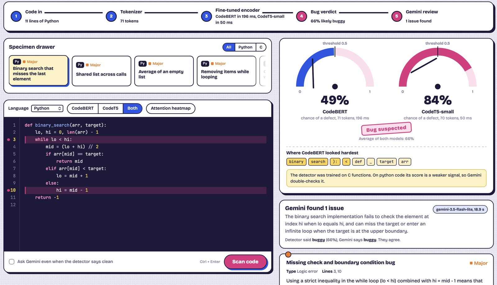
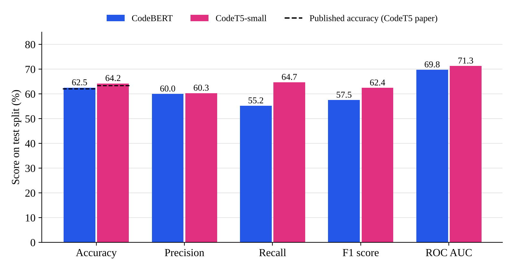
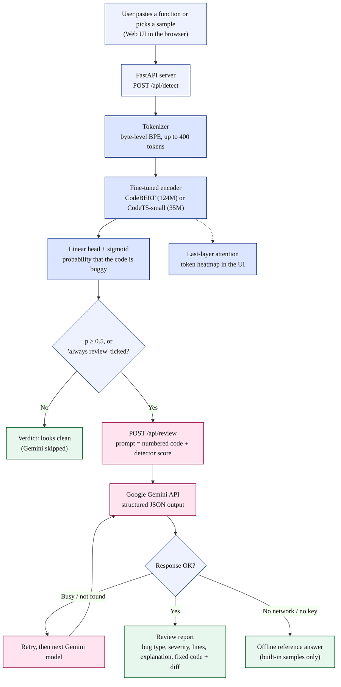
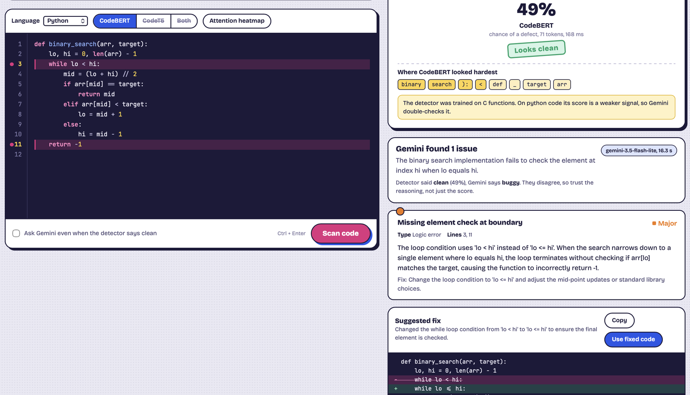
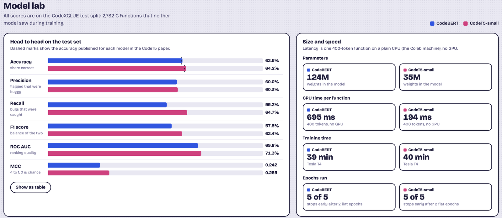
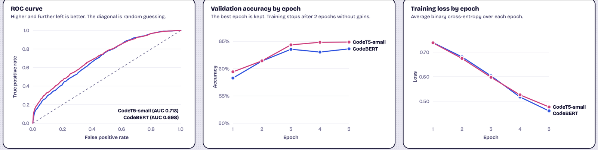

# BugLens: intelligent code review and bug detection with LLMs

BugLens finds bugs in source code and explains them. It works in two stages:

1. **Detect.** A fine-tuned code model (CodeBERT or CodeT5-small) reads a function and gives the probability that it contains a bug.
2. **Explain.** If the code is flagged, Google Gemini writes a structured review: bug type, severity, line numbers, a plain-English explanation and the corrected code.

The web app shows the whole pipeline live, with an attention heatmap over the code, a diff of the fix, and a dashboard comparing the two models.

Course project for **Deep Learning for Data Analytics (BCSML0555B)**, B.Tech CSE (Data Science), NIET Greater Noida.



## Results

Both models were fine-tuned on [CodeXGLUE Defect Detection](https://huggingface.co/datasets/google/code_x_glue_cc_defect_detection) (27,318 real C functions from FFmpeg and QEMU) on a Google Colab T4 GPU, and evaluated on the 2,732-function test split.

| Metric | CodeBERT | CodeT5-small |
|---|---|---|
| Accuracy | 62.52% (published: 62.08%) | **64.24%** (published: 63.40%) |
| Precision | 60.00% | **60.33%** |
| Recall | 55.22% | **64.70%** |
| F1 score | 0.575 | **0.624** |
| ROC AUC | 0.698 | **0.713** |
| MCC | 0.242 | **0.285** |
| Parameters | 124M | **35M** |
| CPU time per function | 695 ms | **194 ms** |

Published accuracy is from the CodeT5 paper (Wang et al., EMNLP 2021). CodeT5-small beat CodeBERT on every metric while being about 3.5 times smaller and faster.



On a small hand-written probe of Python and C bug pairs, both detectors were close to chance, so they don't transfer well beyond the C code they were trained on. That is why Gemini verifies and explains every flagged function.

## How it works



| Stage | What happens |
|---|---|
| Tokenize | Byte-level BPE tokenizer, code cut to 400 tokens |
| Encode | CodeBERT (first-token pooling) or CodeT5-small encoder (mean pooling) |
| Classify | Linear layer + sigmoid gives P(buggy); 0.5 or more is flagged |
| Attention | Last-layer attention mapped back onto the code as a heatmap |
| Review | Gemini returns JSON: verdict, issues (type, severity, lines, explanation), fixed code |
| Fallbacks | Retries busy Gemini models, switches models automatically, offline answers for built-in samples |

## Screenshots

| Gemini review and fix | Model lab |
|---|---|
|  |  |



## Run it locally

You need Python 3.10 or newer.

**1. Get the trained models.** Model weights are too large for GitHub. Either train them yourself (next section) or download `buglens_trained.zip` from the link below and unzip it inside this folder, so you have `models/codebert`, `models/codet5` and `results/`.

Trained models: _add your Google Drive link here_

**2. Add a Gemini API key.** Get a free key at https://aistudio.google.com/apikey, then:

```bash
cp .env.example .env
# open .env and paste your key after GEMINI_API_KEY=
```

**3. Start the app.**

```bash
# macOS / Linux
bash run.sh

# Windows
run.bat
```

The first run creates a virtual environment and installs the packages (a few minutes). The browser opens at http://localhost:8000.

## Train the models

1. Open `training/BugLens_training.ipynb` in [Google Colab](https://colab.research.google.com).
2. `Runtime > Change runtime type > T4 GPU`, then `Runtime > Run all`.
3. About 80 minutes later, `buglens_trained.zip` downloads. Unzip it into this folder.

The notebook is generated from `app/modeling.py` and `training/train.py` by `training/make_notebook.py`, so the trained model is exactly the one the app serves.

## Project structure

```
app/
  main.py          FastAPI server and REST API
  modeling.py      DefectClassifier, tokenizer loading, save and load
  detector.py      Stage 1: probability and attention heatmap
  reviewer.py      Stage 2: Gemini review, retries and fallbacks
  samples.py       18 buggy and fixed code pairs (gallery + probe set)
static/            Web UI (plain HTML, CSS, JS; no external libraries)
training/
  train.py                  Fine-tuning and evaluation
  BugLens_training.ipynb    One-click Colab notebook
  make_notebook.py          Builds the notebook from the source files
data/probe_set.json         Cross-language probe (13 Python + 5 C pairs)
docs/images/                Diagrams and screenshots
models/, results/           Filled by training (models are not committed)
```

## API

| Endpoint | Purpose |
|---|---|
| `GET /api/status` | Loaded models, Gemini status and last error |
| `GET /api/samples` | Built-in buggy and fixed samples |
| `POST /api/detect` | Run one or both detectors |
| `POST /api/review` | Gemini review as structured JSON |
| `GET /api/results` | Training results for the Model lab |

## Limitations

- Devign is a hard dataset. Published accuracy for models of this size is 62 to 66%.
- The detectors are trained on C only, so their scores on other languages are a weak signal.
- Attention weights are a rough signal of where the model looked, not proof of why it decided.
- Functions longer than 400 tokens are scored on the first 400 tokens only.
- Gemini reviews need internet and an API key, and can occasionally be wrong.

## Tech stack

PyTorch, Hugging Face Transformers, scikit-learn, Google Gemini API (`google-genai`), FastAPI, Uvicorn, HTML/CSS/JavaScript, Google Colab.

## References

1. Feng et al., *CodeBERT: A Pre-Trained Model for Programming and Natural Languages*, Findings of EMNLP 2020.
2. Wang et al., *CodeT5: Identifier-aware Unified Pre-trained Encoder-Decoder Models for Code Understanding and Generation*, EMNLP 2021.
3. Lu et al., *CodeXGLUE: A Machine Learning Benchmark Dataset for Code Understanding and Generation*, NeurIPS 2021.
4. Zhou et al., *Devign: Effective Vulnerability Identification by Learning Comprehensive Program Semantics via Graph Neural Networks*, NeurIPS 2019.
5. Gemini Team, Google, *Gemini: A Family of Highly Capable Multimodal Models*, 2023.

## Team

- _Name 1 (Roll no.)_
- _Name 2 (Roll no.)_

Supervisor: _Ms. ..._, Assistant Professor, Department of CSE (Data Science), NIET Greater Noida.
